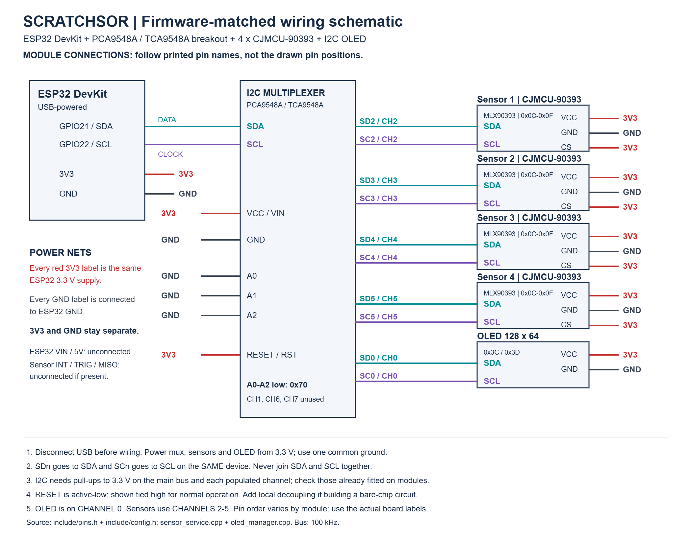

# SCRATCHSOR wiring guide

Hardware: ESP32 DevKit V1 (30-pin, USB-C, CH9102X USB-UART) + PCA9548A/TCA9548A
8-channel I2C multiplexer + 4x CJMCU-90393 (MLX90393) magnetometer modules +
0.96" 128x64 I2C OLED. One shared I2C bus, GPIO21 = SDA, GPIO22 = SCL,
100 kHz (`include/config.h`, `include/pins.h`).

Every claim below is tagged **[verified]** (datasheet/vendor documentation, or
firmware behavior in this repo) or **[assumed]** (typical of the module family
but not confirmed on the exact batch you bought — check with a multimeter).

---

## 1. Connection table (controller side)

The only wires leaving the ESP32 are the I2C pair and power. Everything else
hangs off mux channels.

| ESP32 DevKit pin | Connects to | Notes |
|---|---|---|
| GPIO21 (SDA) | Mux module SDA | Default Wire SDA [verified — DevKit V1 pinout] |
| GPIO22 (SCL) | Mux module SCL | Default Wire SCL [verified — DevKit V1 pinout] |
| 3V3 | Mux module VCC/VIN | See §5 power notes |
| GND | Mux module GND | Common ground for the whole bus |
| EN | — leave unconnected | Active-low reset, pulled up on-board |
| VIN/5V | — not used | USB supplies the board; do not feed sensors from 5V |

Nothing else is wired. **Do not** hang devices on GPIO9/10/11 (internal SPI
flash), GPIO12 (boot strapping — a pull-up here prevents booting), or
GPIO0/2/5/15 (strapping pins). The MLX90393 INT and TRIG pins are not wired:
the driver uses single-measurement mode and waits the computed conversion
time instead of an interrupt [verified — `mlx90393.h` `conversionTimeMs()`;
datasheet §14 single-measurement mode].

## 2. Mux channel allocation

Firmware constants: `kMuxChSensor[4] = {2,3,4,5}`, `kMuxChOled = 0`.

| Mux channel | Device | Expected 7-bit address |
|---|---|---|
| CH0 / SD0, SC0 | 0.96 inch OLED | 0x3C (alt 0x3D) |
| CH1 | unused | — |
| CH2 / SD2, SC2 | Sensor 1 (logical ID 0) | 0x0C–0x0F |
| CH3 / SD3, SC3 | Sensor 2 (logical ID 1) | 0x0C–0x0F |
| CH4 / SD4, SC4 | Sensor 3 (logical ID 2) | 0x0C–0x0F |
| CH5 / SD5, SC5 | Sensor 4 (logical ID 3) | 0x0C–0x0F |
| CH6–CH7 | unused | — |

All four sensors are required for fingerprint collection and classification.
Missing sensors leave the dashboard and Wi-Fi management accessible.

All four sensors may use the *same* address — that is the point of the mux.
Each sensor channel is scanned independently at boot
(`Mlx90393::begin` probes 0x0C..0x0F on its own channel).

> **Address-variant caveat [verified — Melexis ordering table]:** MLX90393 is
> factory-programmed in four base-address option codes. `ABA-011` (the usual
> CJMCU-90393 population) answers at 0x0C–0x0F. `ABA-014` answers at
> 0x18–0x1B — Adafruit moved to that variant in May 2023. Firmware scans only
> `kMlxAddrMin..kMlxAddrMax` = 0x0C..0x0F; a module built on another option
> code ACKs at a different address and will show as NOT_FOUND. Confirm by
> running an I2C scan on the sensor's channel.

## 3. Per-module wiring

### 3.1 PCA9548A / TCA9548A mux module

| Mux pin | Connect to | Requirement |
|---|---|---|
| VCC / VIN | ESP32 3V3 | PCA9548A: 2.3–5.5 V; TCA9548A: 1.65–5.5 V [verified — TI datasheets] |
| GND | ESP32 GND | |
| SDA | ESP32 GPIO21 | |
| SCL | ESP32 GPIO22 | |
| A0, A1, A2 | leave unconnected | On common modules these are pulled low on-board → address 0x70 [verified — Adafruit docs]. If bare PCB or unsure: tie all three to GND. |
| RESET / RST | leave unconnected **or** 10k→3V3 | Active-low; datasheet requires pull-up to VCC. Most modules pull it up on-board [verified — Adafruit pinout docs; **assumed** for generic purple/blue modules — measure RST→VCC resistance; if open, add 10 kΩ to 3V3]. |
| SD2/SC2 … SD5/SC5 | sensors 1–4 SDA/SCL | one CJMCU-90393 per channel |
| SD0/SC0 | OLED SDA/SCL | SDA to SD0, SCL to SC0 |
| SD1/SC1, SD6/SC6, SD7/SC7 | unconnected | unused |

Power-up behavior: the mux boots with **all channels deselected** and holds
internal power-on reset until VCC ≥ VPOR (~1.2–1.5 V on TCA9548A) — no
channel-selection glitches at power-on [verified — TI datasheet §8.4].
RESET errata note: never drive RESET above VCC [verified — TI datasheet].

### 3.2 CJMCU-90393 magnetometer modules (x4, identical wiring each)

| Module pin | Connect to | Requirement |
|---|---|---|
| 3V3 / VCC | Mux-channel-independent 3V3 rail (ESP32 3V3) | MLX90393 supply is 2.2–3.6 V [verified — datasheet]. The CJMCU-90393 has **no regulator** — vendor listings describe it as a "3.3 V breakout" and the chip range is quoted directly; power it at 3.3 V only, never 5 V [assumed — no regulator visible in vendor photos/specs; confirm on your board: an LDO would be a 3-pin SOT-23 near VCC]. |
| GND | common GND | |
| SDA | mux SD_n (channel n = logical sensor ID + 2) | |
| SCL | mux SC_n | |
| CS | see CS checklist below | MLX90393 MS/CS pin must be at VDD_IO for I2C mode [verified — datasheet pin table]. Floating CS = device never ACKs [verified — SparkFun engineering note]. |
| INT | unconnected | optional data-ready output; unused (fixed conversion-time polling) |
| TRIG / INT-TRIG | unconnected | optional; unused |
| MISO | unconnected | SPI only |

**CS handling — read this before powering.** The datasheet requires CS high
for I2C. Whether your board does it for you depends on the batch:

- The CJMCU-90393 underside has an A0/A1 address-jumper area and a **CS
  pull-up configuration area** [verified — vendor listing]. On most shipped
  boards this defaults CS high so I2C works out of the box [assumed —
  consistent with ESP32 field reports of plug-and-play I2C, but not
  guaranteed across sellers].
- **Check each board:** power the module standalone at 3.3 V and measure
  resistance between the CS pin and 3V3. A few kΩ (or a short, if a solder
  bridge is present) = CS is pulled up; open = CS is floating.
- If floating: either bridge the CS jumper pad on the underside, or wire the
  CS header pin straight to 3V3. Wiring CS to 3V3 externally is always safe,
  even when a pull-up already exists.

**A0/A1 solder jumpers** (module underside): both LOW by default → 0x0C.
Bridging a pad (or wiring the pin high) sets that address bit: A1A0 =
00→0x0C, 01→0x0D, 10→0x0E, 11→0x0F [verified — datasheet + Adafruit forum].
We do **not** rely on different addresses (the mux gives channel isolation);
leave them at default.

**On-board I2C pull-ups:** the CJMCU-90393 carries ~10 kΩ pull-ups on SDA/SCL,
enabled by default [verified — ESP32 integration notes for this module]. Since
each sensor sits behind its own mux channel, only the currently-selected
channel's pull-ups load the bus; four modules do **not** parallel up.
[assumed for the exact resistor value — measure SDA→3V3 on an unpowered
module if you need certainty; ~10 kΩ expected.]

**INT alternative:** with INT unwired, the driver issues SM (single
measurement) and waits `conversionTimeMs()` — a function of OSR, DIG_FILT
and RES — then reads with RM [verified — `mlx90393.h`]. If you later wire
INT, it can mark data-ready instead of timed polling.

### 3.3 0.96" OLED module (mux CH0)

| OLED pin | Connect to | Notes |
|---|---|---|
| VCC | 3V3 | most 4-pin modules accept 3.3–5 V; 3.3 V is always safe |
| GND | GND | |
| SDA | mux SD0 | |
| SCL | mux SC0 | |

Typical address 0x3C (some modules 0x3D; firmware probes both)
[verified — `config.h` kOledAddrPrimary/Alt].

**Controller: SSD1306 or SH1106?** Both sell as "0.96 128x64 I2C" and both
answer at 0x3C/0x3D — an I2C scan cannot tell them apart, and cheap modules
rarely implement a reliable read-back ID path [verified — multiple sources].
Differences that matter:

- SSD1306 has 128 columns of RAM; SH1106 has 132, and the glass is wired to
  SEG2..SEG129 → driven with SSD1306 firmware, an SH1106 panel shows a
  **2-pixel column offset / clipped right edge** [verified — SH1106
  datasheet geometry + multiple driver docs].
- Firmware default: SSD1306 (`controller` reported in health JSON).
  If you see the 2-px offset, set `oled.controller` to `2` (SH1106) in
  Settings or `POST /api/v1/config` (`controllerOverride`: 0=auto, 1=SSD1306,
  2=SH1106 — see `device_types.h` OledConfig). [verified — `oled_manager.h`]

## 4. Wiring diagram



[Scalable SVG](wiring-schematic.svg). The labels show OLED CH0 and sensors CH2–5;
follow the module's printed pin names rather than its drawn pin positions.

## 5. Power and ground notes

- **Rail budget.** DevKit 3V3 comes from the on-board LDO (typically AMS1117);
  ~500 mA is a realistic total budget and the ESP32 radio already draws large
  bursts from it [verified — DevKit V1 references]. Our downstream load:
  - MLX90393: ~100 µA typ quiescent, few mA during conversion bursts → 4
    sensors ≈ tens of mA worst case [verified — vendor hookup guide;
    conversion-current figure assumed, depends on OSR].
  - Mux: µA-scale standby [verified — datasheet "low standby current"].
  - OLED: ~10–30 mA depending on pixels lit [assumed — typical module range].
  - Total: well under 100 mA → comfortably within budget over USB. **But:**
    the sensors' magnetic performance degrades with rail noise; keep them on
    the same regulated rail and short leads.
- **Never power CJMCU-90393 at 5 V** (no regulator — §3.2). The mux and most
  OLED modules tolerate 5 V, but mixing rails complicates logic levels;
  keep the whole assembly at 3.3 V.
- Single shared GND. Do not power sensors from a separate supply without
  joining grounds.
- USB-C cable quality matters: thin cables droop during Wi-Fi bursts and
  cause brown-out resets that look like software bugs.

## 6. Breadboard layout & magnetic cleanliness

These are magnetometers: every permanent field source near them is a
systematic offset. Layout rules:

- **Sensor spacing:** ≥ 2 cm between sensor centers, more if you want to
  treat the four readings as independent. Closer spacing means each sensor
  sees the others' surroundings but also means less spatial coverage.
- **Orientation:** mount all four with axes aligned the same way (silkscreen
  arrows/logo orientation identical). Mixed orientations are legal — the
  driver doesn't assume an axis convention — but calibration math and
  debugging are far easier when axes match.
- **Distance from interferers:** keep sensors ≥ 3–4 cm from the ESP32 module
  (its RF shield can is ferromagnetic metal), from the USB cable, and from
  the OLED bezel screws. Speaker magnets, phone vibrate motors, screwdrivers
  and steel rulers on the bench all register.
- **Ferrous-free zone:** use plastic/nylon standoffs and screws if you mount
  the sensors. A steel bolt 1 cm away produces a larger offset than the
  signal you may be trying to measure.
- Keep the I2C leads to sensors short (≤ 10–15 cm Dupont; longer works but
  raises capacitance — drop to 100 kHz if you see flaky reads over long
  wires) [verified — community experience with these modules; 400 kHz
  default is fine on a breadboard].
- The measurement magnet (calibration target) moves relative to the array;
  everything else magnetic must stay fixed between baseline and collection —
  see `docs/calibration.md`.

## 7. Pull / jumper checklist

| Signal | Required state | How it's achieved | Check |
|---|---|---|---|
| Mux A0/A1/A2 | low → 0x70 | on-board pull-downs | [assumed on generic modules; verified on Adafruit] measure or tie to GND |
| Mux RST | high | on-board pull-up most modules | measure RST→VCC; add 10 kΩ if open |
| Sensor CS x4 | high | on-board pull-up or jumper pad, batch-dependent | measure CS→3V3 per board; wire CS→3V3 if open |
| Sensor A0/A1 x4 | low → 0x0C | default jumper state | leave pads unbridged |
| Bus SDA/SCL pull-ups (primary) | present | mux module usually carries pull-ups; OLED module adds more | too many parallel pull-ups weakens noise margin; if SDA/SCL idles low or waveforms are sluggish, remove duplicates |
| ESP32 EN | high | on-board | nothing to wire |

## 8. Pre-power checklist

1. Mux at 0x70 (A0/A1/A2 low) and RST pulled high.
2. Each CJMCU-90393: VCC wired to 3V3 **only**, CS confirmed high (§3.2).
3. One sensor per mux channel CH2–5; OLED on CH0; nothing on CH1, CH6–7.
4. SDA→GPIO21, SCL→GPIO22 (not swapped — swapped lines produce exactly the
   "mux not found" boot error).
5. All GNDs joined.
6. No conductive debris on the breadboard; nothing ferrous within ~3 cm of
   the sensors.

## 9. Verify-before-powering (multimeter, unpowered)

| Check | Method | Pass criterion |
|---|---|---|
| 3V3↔GND short | continuity across the rail | no beep (open / high-Ω) |
| VCC on each sensor | continuity ESP32 3V3 → sensor VCC pin | beep on all 4 |
| SDA/SCL not shorted | continuity SDA↔SCL at ESP32 pins | no beep |
| SDA reaches mux | continuity GPIO21 pad → mux SDA pad | beep |
| CS high on each sensor | resistance CS pin → sensor 3V3 pin | ≤ ~10 kΩ or short |
| RST high on mux | resistance RST → VCC | ≤ ~10 kΩ |
| Sensor VCC not 5V | (visual) VCC wire goes to 3V3 pin, not VIN | confirmed |

Then power via USB and read the boot banner — `tools/serial_diagnostics.py`
automates checking "PCA9548A found", the mux channel map, and
"Magnetometers online: n/4".

## 10. What "works" looks like at boot

Serial @115200 should show, in order:

```
[I] SCRATCHSOR firmware 0.1.0
[I] PCA9548A found at 0x70
[I] mux map: CH0: 0x3C  CH2: 0x0C  CH3: 0x0C  CH4: 0x0C  CH5: 0x0C
[I] OLED at 0x3C controller=1
[I] Magnetometers online: 4/4
[I] AP SSID SCRATCHSOR-XXXX  portal http://192.168.4.1
```

Degraded but acceptable variants are documented in `docs/architecture.md`
(failure matrix) and `docs/troubleshooting.md` (fixes).

## Sources

- Melexis, *MLX90393 datasheet* — pin table (MS/CS→VDD_IO for I2C), ordering
  codes (I2C address 00011xx/00100xx/00101xx/00110xx), single-measurement
  mode: https://media.melexis.com/-/media/files/documents/datasheets/MLX90393-datasheet-melexis.pdf
- TI, *TCA9548A datasheet (Rev. H)* — 1.65–5.5 V supply, RESET active-low,
  power-up all channels deselected, VPOR: https://www.ti.com/lit/ds/symlink/tca9548a.pdf
- TI/NXP, *PCA9548A datasheet (Rev. G)* — 2.3–5.5 V supply, RESET must be
  pulled to VCC via resistor, RESET>VCC errata:
  https://www.ti.com/lit/ds/symlink/pca9548a.pdf
- Adafruit, *TCA9548A breakout pinouts* — RST pulled high on-board, A0–A2
  pulled low → 0x70: https://learn.adafruit.com/adafruit-tca9548a-1-to-8-i2c-multiplexer-breakout/pinouts
- Elecbee CJMCU-90393 listing — underside A0/A1 jumpers + "CS pull-up
  configuration area", 3.3 V breakout, no regulator mentioned:
  https://www.elecbee.com/en/product-detail/90393-mlx90393-digital-3d-hall-sensor-displacement-angle-rotate-3d-position_25055
- pantaluna/esp32_mlx90393_sensor_using_lib — CJMCU-90393 breakout contains
  ~10 kΩ SDA/SCL pull-ups enabled by default; INT optional with fixed-delay
  alternative:
  https://github.com/pantaluna/esp32_mlx90393_sensor_using_lib/blob/master/components/mjd_mlx90393/README.md
- SparkFun, *Soldering and Troubleshooting Homebrew PCBs* — floating CS
  produced total I2C silence on MLX90393: https://news.sparkfun.com/2295
- SparkFun, *Qwiic MLX90393 Hookup Guide* — CS tied high via trace jumper;
  onboard pull-ups; parallel pull-ups warning: https://learn.sparkfun.com/tutorials/qwiic-magnetometer-mlx90393-hookup-guide/all
- Adafruit, *MLX90393 pinout* — A0/A1 low by default, on-board SDA/SCL
  pull-ups, CS tied high (I2C-only board):
  https://learn.adafruit.com/mlx90393-wide-range-3-axis-magnetometer/pinout.md
- Adafruit forums — A1/A0 → 0x0C/0x0D/0x0E/0x0F mapping:
  https://forums.adafruit.com/viewtopic.php?t=191173
- Adafruit CircuitPython_MLX90393 issue #46 — post-May-2023 base address
  0x18 (ABA-014 option code): https://github.com/adafruit/Adafruit_CircuitPython_MLX90393/issues/46
- SH1106/SSD1306 differences (132 vs 128 RAM columns, 2-px offset):
  https://ashllll.github.io/xiao-esp32-platformio-idf/research/oled-128x64-primary-sources/
  and https://docs.rs/rsemu/latest/rsemu/dev/solomon/ssd1306/index.html
- ESP32 DevKit V1 30-pin pinout (GPIO21/22 I2C, strapping-pin warnings,
  3V3 budget): https://learn.lonelybinary.com/pinouts/esp32-devkit-v1 and
  https://bananaboard.app/parts/esp32-devkit-v1

*Unverifiable without your exact modules: CJMCU-90393 CS pull-up default
state, on-board pull-up resistor values, OLED controller type, whether your
mux module pulls RST up. All four have a listed check above; none blocks
assembly — measure before powering.*
